  

I build web platforms and business systems end to end, from the database schema to the last detail of the interface. Most of my work is .NET and Laravel on the back end with React on the front. I also work as a visual designer, so I care about how software feels to use as much as how it runs.

- 🏛️ Software engineering intern at **CNRS Lebanon**
- 🩺 Building **[TheraLink](https://theralink.cloud)**, practice management software for physiotherapy clinics in Lebanon
- 🎓 Computer Science at Antonine University, graduating December 2026

### Selected work

**[Smart SIS](https://github.com/najdihussein2025/smart-sis)**: an AI-assisted student information system for Antonine University. ASP.NET Core API, React + TypeScript front end, and a Python service that answers student questions from university documents. Built with a team of three.

**[Online Learning Platform](https://github.com/najdihussein2025/OnlineLearningPlatform)**: a full e-learning platform built during my internship at IDS. Courses, quizzes, progress tracking, certificates with verification codes, real-time chat with SignalR, and an AI assistant.

**[Task Management System](https://github.com/najdihussein2025/TaskManagementSystem)**: an ASP.NET Core MVC app with separate admin and user dashboards, categories, reports and email-based password reset.

**[TheraLink](https://theralink.cloud)**: appointments, patient records, session notes, exercise library and WhatsApp reminders for physio clinics. Private repo, currently pre-launch.

**Freelance**: a .NET desktop system for an agriculture shop (inventory, sales, customers) and a Laravel tutoring platform for [Original IQ](https://www.original-iq.com/).

### Tools I use

  

### Get in touch

[Portfolio](https://najdihussein2025.github.io) · [Email](mailto:husseinnajdi2025@outlook.com)
