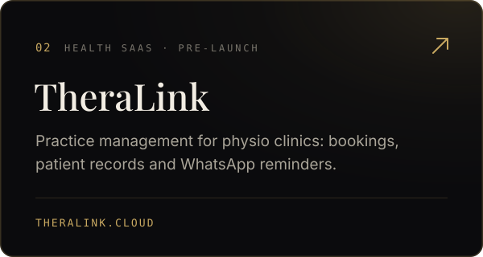
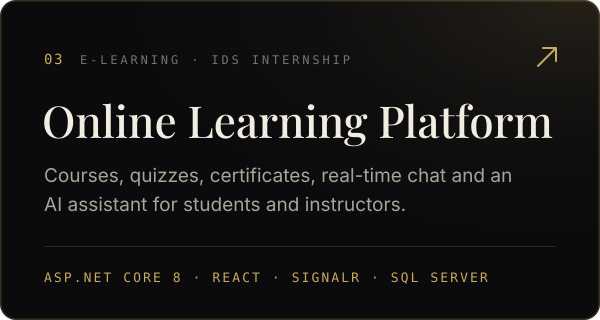

I build web platforms and business systems end to end, from the database schema to the last detail of the interface. Most of my work is .NET and Laravel on the back end with React on the front. I also work as a visual designer, so I care about how software feels to use as much as how it runs.

- Software engineering intern at **CNRS Lebanon**
- Building **[TheraLink](https://theralink.cloud)**, practice management software for physiotherapy clinics in Lebanon
- Computer Science at **Antonine University**, graduating December 2026

### Selected work

  
  

  
  

### Tools

### Contact

[Portfolio](https://najdihussein2025.github.io) · [LinkedIn](https://www.linkedin.com/in/hussein-najdi/) · [Email](mailto:husseinnajdi2025@outlook.com)
